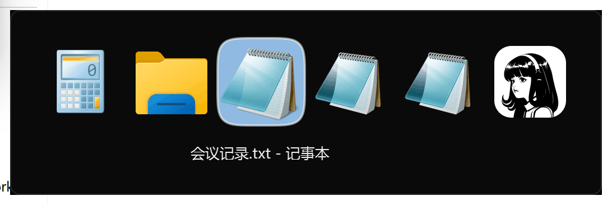

# SwitchTask


一款专为 Windows 打造的 **macOS 风格独立窗口切换器**：
每个窗口独立展示、按最近使用排序、即选即切。深度融合 **macOS 26 现代化大画幅实时缩略图舞台**、**物理隔离的工业级输入钩子线程**、**macOS 黄金视觉重心居中**与 **8K 视网膜级超高分辨率适配**。支持 Windows 10 / 11（64 位）。


> **图示说明 · 经典界面架构**：深石墨通透毛玻璃底板、马卡龙超椭圆（Squircle）连续曲率选中底、原生 1:1 像素锐利应用图标与居中平滑截断标题。在 v3.3 中，上方更深度融入了 macOS 26 现代化大画幅实时缩略图舞台与黄金视觉重心居中微调。

## 📦 下载与安装

前往 [Releases 页面](https://github.com/Crucialmer/SwitchTask/releases/latest) 下载 `SwitchTask.zip` 便携包，解压即用，运行 `SwitchTask.exe`（内置 Qt 6.8 运行库，纯绿色免安装）。已运行用户可在托盘菜单使用「Check for Updates」一键在应用内安全自动更新。

---

## ⚡ 主要功能

### 1. `Alt+Tab`：在窗口间切换

- 按住 `Shift` 反向切换；选中项高亮（马卡龙方圆角选中底 + 图标放大动效）
- 松开 `Alt` 后切换器保持常驻显示：鼠标单击图标**直接切换**（`Enter` / 空格亦可确认），`Esc` / 点击别处取消
- `Ctrl`+`Alt`+`Tab`：同 `Alt`+`Tab`（拦截系统固定切换器，行为与按下 `Alt`+`Tab` 一致）
- 每个窗口独立一项，按各自**最近使用**排序；底部实时显示选中窗口的完整标题（超长智能中部省略）


> **动图演示 · 键盘快速切换与驻留选择**：
> - **顺畅键鼠交互**：单手轻按 Alt+Tab 顺序切换，搭配 Shift 逆向循环，选中项呈马卡龙方圆角高亮；
> - **松开自动驻留**：松开 Alt 键后切换器保持常驻显示，支持鼠标单击图标即刻切换，亦可敲击 Enter / 空格键确认，按 Esc 或点击外部优雅取消；
> - **毫秒级联动**：上方大画幅实时缩略图与下方完整标题跟随焦点同步切换，零延迟、零闪屏。

### 2. 鼠标悬停即时选中 · 中键关闭窗口

- 鼠标悬停在图标上**实时选中**：底部标题与上方大画幅缩略图随光标位置即时更新，无需先点击
- **鼠标中键**单击图标 = 关闭该窗口（发送正常关闭请求，可触发应用自身的保存确认）
- `Ctrl`+`W`：关闭当前选中的窗口（等效中键单击）


> **动图演示 · 鼠标即时追踪与中键快速关闭**：
> - **悬停即时感知**：光标轻掠任意图标即刻触发焦点选中、实时缩略图无损投屏及标题刷新（无须先点击鼠标）；
> - **中键优雅关闭**：鼠标中键单击图标（或按下 Ctrl+W），向目标程序投递正常关闭请求（支持拦截触发未保存确认），窗口销毁后列表项原地平滑复用移除。

### 3. macOS 26 原生实时窗口缩略图大画幅预览 (DWM 硬件级零 CPU 渲染)

```text
┌─────────────────────────────────────────────────────────────────┐
│                     macOS 26 视窗舞台 HUD                        │
│  ┌───────────────────────────────────────────────────────────┐  │
│  │                                                           │  │
│  │     DWM GPU 硬件级 50% 巨幕实时缩略图 (最高 8K / 5000 × 2100)  │  │
│  │       (DirectComposition 免遮挡 / 60fps 实时视频与代码)   │  │
│  │                                                           │  │
│  └───────────────────────────────────────────────────────────┘  │
│                                                                 │
│   [ 🌐 浏览器 ]    [ 💻 IDE ]    [ ★ 选中窗口 ]    [ 📂 文件 ]   │
│                                 (n=5 超椭圆底)                  │
│                                                                 │
│                 GitHub - Crucialmer/SwitchTask                  │
│                      (居中标题智能中段省略)                       │
└─────────────────────────────────────────────────────────────────┘
```

依托 Windows 桌面窗口管理器（DWM）底层硬件重定向交换链，实现**零 CPU 损耗的 GPU 硬件级实时缩略图投影**，并支持以下三种预览模式（可在托盘设置或配置文件中自由选择）：

- **🌟 舞台集成大画幅（Integrated Stage HUD，默认推荐）**：
  - 切换器面板垂直拓展为一体化悬浮大舞台，舞台高度动态自适应当前屏幕可用高度的 **50% 巨幕**（1080p 下达 **`516px`**，8K 下达 **`2112px`**），画幅面积较原版暴增 **258%（翻 3.6 倍）**，代码行与网页文字清晰可读；
  - 采用 macOS 现代化 **16px 连续大曲率内凹圆角** 与顶端 1px 内切漫反射微光线，在磨砂毛玻璃底板上形成深邃立体的视窗展台效果；
  - **多行折行自适应让渡**：窗口过多（20+）触发折行时舞台自动微调让渡至 38%，确保多窗口下垂直呼吸感依旧；
  - **8K 全链路大标题联动**：长标题容纳上限随屏幕宽度自适应拓展至 60%（8K 下达 4600px+ 无截断），悬浮卡片按屏幕比例动态响应。
- **悬浮微型视窗（Floating Preview Island）**：
  - 选中的应用图标正上方平滑浮现深石墨半透明亚克力卡片（规格按屏幕比例动态响应伸缩），随焦点平滑横向位移，等比高清投影窗口实时画面。
- **极速性能模式（Disabled）**：
  - 彻底关闭缩略图画面，回退至纯极速图标切换模式，满足极客与超低功耗设备需求。
- **DirectComposition 硬件视频与抗遮挡深度优化**：
  - 深度兼容 Chrome/Edge 浏览器全屏、YouTube/B站硬件加速视频播放以及大型 IDE；针对免遮挡视窗与 DirectComposition 视口穿透，彻底杜绝后台视频冻结或黑屏。

### 4. macOS 黄金视觉重心居中定位

- **剔除任务栏干扰**：居中基准从粗暴的全屏几何中心切换为**剔除任务栏后的实际可用桌面工作区（`availableGeometry`）**；
- **自适应上浮 4.5%**：在可用工作区中心的基础上向上微偏可用高度的 $4.5\%$（1080p 上浮约 46px，2K 屏约 62px，4K 屏约 95px，全分辨率自适应）；
- **视平线自然焦点**：上留白与下留白呈现优美的 **$1 : 1.25$ 黄金分割**，核心大画幅缩略图刚好落在平视自然焦距线，彻底消除底部重力视错觉与压迫感。

### 5. `Alt+`` `：在同一应用的多个窗口间轮换

- 按住 `Shift` 反向切换；**最近活动**的窗口优先访问
- 切换器未显示时用于同应用窗口轮换（显示时 `` ` `` 键用于列表选择）

### 6. 滚轮与键盘全能操作

- 滚轮悬停图标：↑ 该窗口**置顶预览**（不改变焦点）/ ↓ **最小化**该窗口
- 循环选择：`Tab`·`Shift`+`Tab` / `` ` ``·`Shift`+`` ` `` / `←`·`→`；`↑`·`↓`：该窗口**置顶预览** · **最小化**
- Vim 风格快捷键：`H` `L` 切换选中 / `K` 置顶预览 · `J` 最小化（与方向键 ↑/↓ 语义一致）
- `Enter` / 空格：确认切换 · `Esc` / 点击别处：取消

### 7. 任务栏滚轮切换（高频短路优化）

- 在任务栏应用图标上滚动：↑ 切换到上一个窗口 / ↓ 最小化上一个窗口；
- 引入外接矩形（Rect）高速初筛，全系统 99.9% 的常规滚轮滚动在 $0.001\text{ms}$ 内短路放行，零系统开销。

---

## 🌟 极致性能与架构亮点

- **🔒 输入钩子专属独立线程（Dedicated Hook Threads）**：
  - 全局低级键鼠钩子（`WH_KEYBOARD_LL` 与 `WH_MOUSE_LL`）从 Qt GUI 主线程彻底剥离，移入独立的最高优先级专属 Win32 线程（`THREAD_PRIORITY_HIGHEST`），运行原生独立消息泵。
  - 即便主线程在进行复杂 D3D 渲染或重绘，操作系统的键盘打字与鼠标滚轮依然保持丝滑，从根本上根除 Windows 系统的 `LowLevelHooksTimeout` 强制掉钩与按键假死隐患。
- **⚡ 零系统调用修饰键状态机（Zero-Syscall Modifier Tracking）**：
  - 彻底废除按键钩子回调中频繁触发内核态切换的 `GetAsyncKeyState` 系统调用；
  - 纯利用 `KBDLLHOOKSTRUCT` 硬件原生标志位（`LLKHF_ALTDOWN`）与线程本地状态机跟踪 Alt/Ctrl/Shift/Win 状态，响应进入亚微秒级位运算。
- **🔥 呼出热路径零堆分配（Hot Path In-Place Reuse）**：
  - 废除每次呼出切换器时对 `QListWidget` 暴力调用 `clear()` 销毁重建所有 item 的开销，改为智能 Diff 增量比对并原地复用条目；
  - 窗口合法性过滤前置窗口标题长度与样式位掩码短路，结合静态栈缓冲与 `QStringView`，呼出过程达成 **0 堆内存分配**，彻底根除布局抖动与闪烁。
- **🔄 WinEvent 全局增量窗口管理**：
  - 实时监听 `EVENT_OBJECT_DESTROY`，窗口关闭时毫秒级自动清除失效 HWND 缓存，固定（pinned）状态下即时就地移除对应条目。
- **🚀 后台全异步预热与零冷启动延迟**：
  - 开始菜单快捷方式与 AUMID 映射由主线程迁移至后台 `QThreadPool` 线程池异步构建，彻底消除应用首次冷启动白屏与卡顿。
  - 彻底解耦 WinRT 跨进程 RPC 调用，改用 Windows 原生 C API `GetPackagePathByFullName`。

---

## 🖥️ 顶级视网膜适配：完美支持最高 8K 分辨率

- **Per-Monitor V2 顶级高 DPI 感知**：底层启用 Windows `DPI_AWARENESS_CONTEXT_PER_MONITOR_AWARE_V2` 与 Qt 浮点 DPI `PassThrough` 穿透策略，绝无模糊位图拉伸；
- **256×256 巨型母图标（SHIL_JUMBO）**：原生提取 Windows Shell 最高规格的 $256 \times 256$ 原始高清母图标。在 8K @ 400% 缩放下，64px 图标实现物理点对点 $1:1$ 绝对清晰呈现；
- **全物理矢量渲染**：马卡龙圆角选中底基于 $n=5$ 的超椭圆（Squircle）纯代数方程浮点自绘，在 4K/8K 巨屏下线条如刀锋般锐利无折痕；
- **多显示器动态混合 DPI 漫游**：自动根据鼠标所在屏幕的物理 DPI 和工作区尺寸动态重算几何，完全自适应居中。

---

## 📐 窗口自适应与多行智能布局

- **窗口过多自适应压缩**：当打开的窗口数量较多时，系统先平滑压缩单元格（80px $\rightarrow$ 32px）；
- **全自动多行折叠布局**：若压缩后仍超出屏幕宽度，自动转为多行展示并计算每行条目数，垂直方向实施智能贴边夹取，**确保 100% 窗口清晰可见且绝对可达**，彻底解决传统切换器超出屏幕被裁切截断的缺陷。

---

## 🎨 更多设计特色

- **macOS 26 风格设计**：常暗深色通透 HUD 面板（深石墨半透明底 + 浅色文字 + 顶缘受光 + 细描边）；马卡龙·婴儿蓝连续曲率方圆角选中底（n=5 超椭圆，圆润饱满零折痕）；无损保留应用图标原生 1:1 像素锐利度；底部标题水平恒定绝对居中（无横向跳动，中段智能省略）；
- **macOS 26 风格弹出窗口与现代控件**：独立设置窗口（`SettingsDialog`）与检查更新窗口（`UpdateDialog`）全面升格至 macOS 26 规范，集成原生胶囊滑动开关（`MacToggleSwitch`）、分段胶囊选择器（`MacSegmentedControl`）、类别方圆角徽章、Hero 头部高清应用图标与版本胶囊、红黄绿矢量交通灯自绘标题栏，支持无边框拖拽移动、亚克力通透毛玻璃与 Win11 12px 窗口平滑圆角；
- **macOS 26 原生自绘悬浮气泡通知（`MacToast`）**：彻底淘汰 Win11 系统消息弹窗，采用纯自绘亚克力毛玻璃、12px 平滑圆角、左侧 32px 方圆角应用图标与三色矢量状态徽标（成功绿/提示蓝/警告橙）、零焦点抢占（`WA_ShowWithoutActivating` 不打断任何打字或操作）、平滑淡入淡出及悬停驻留机制，右下角优雅呼出；
- **macOS 原生级托盘弹出菜单与静音无扰**：集成两行式专属品牌状态卡片（应用图标 + 品牌名 + 磨砂版本胶囊 + 矢量双层呼吸圆点 + 实时状态行，支持单击直达设置）、268px+ 宽屏黄金比例、统一 38px 文本对齐列、14px 居中对号与 12px+ 舒适间距，以及 Apple 原厂高饱和系统蓝勾选标记与深浅色毛玻璃适配；
- **深浅色模式自适应**：弹窗、设置窗口、更新窗口、托盘菜单（圆角 + 毛玻璃）跟随系统浅色 / 深色模式实时切换；可用 `config.ini` 的 `ThemeMode` 强制指定；
- **QQ 多聊天窗口头像角标识别**：聊天窗口（QQ）多开时，可在应用图标上叠加当前会话头像角标，同应用多窗口一眼可辨；
- **更高权限的窗口（如任务管理器）正常切换**；
- **内置一键自动更新**检查。

---

## 🚀 开机自启动

在托盘菜单中点击「开机自启动」即可设置开机自启动（再次点击取消），启动权限与当前程序权限一致。

---

## ⚙ 配置与纯绿色便携运行

SwitchTask 为 **100% 纯绿色便携软件**：
- **零目录外残留**：配置文件 `config.ini`、更新包及生成的所有文件均严格保存在程序自身所在文件夹内，**绝不会出现在本文件夹以外的任何地方**（绝无 `%APPDATA%` 残留，绝无系统临时目录 `%TEMP%` 垃圾文件）；
- **删除即彻底清理**：移动软件文件夹不影响任何功能；如需移除软件，直接删除本程序文件夹即可 100% 彻底清理。

有两种方式可以修改配置：

1. 直接修改程序目录下的 `config.ini` 文件，并重启程序
2. 🌟[推荐] 单击托盘菜单顶部状态卡片或在托盘菜单「设置...」中点击「打开配置...」，此时会自动用文本编辑器打开配置文件；修改后，保存并**关闭文件**，程序会自动重载配置

### 配置项参考

```ini
; 实时缩略图模式设置
[thumbnail]
mode = integrated ; 缩略图模式: integrated (macOS 26 舞台大画幅，默认推荐) / popup (悬浮卡片) / disabled (关闭预览)

; 字体定制
[label]
font_family = "Microsoft YaHei UI"
font_size = 10.5
font_weight = bold

[menu]
font_family = "Microsoft YaHei UI"
font_size = 13
font_weight = bold

; 界面外观与多显示器
ThemeMode = auto      ; auto 跟随系统深浅色 (默认) / light 强制浅色 / dark 强制深色
DisplayMonitor = 1   ; 0 主屏幕 / 1 跟随鼠标所在屏幕 (默认)
```

---

## 📄 License

本项目采用 [GPL-3.0](LICENSE) 许可发布：可自由使用、修改与分发，衍生作品须同样以 GPL-3.0 开源。

© 2026 Crucialmer