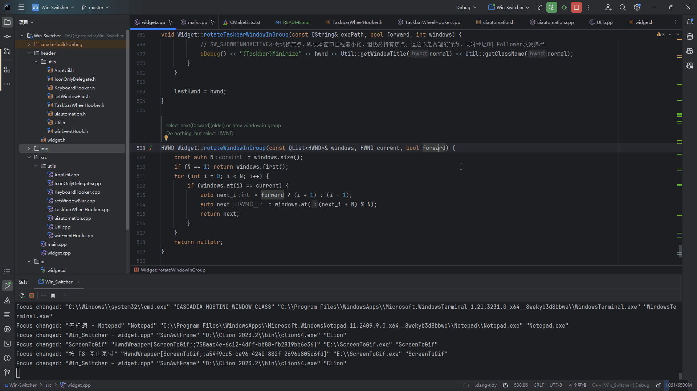
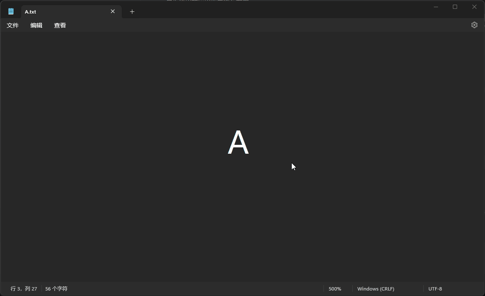
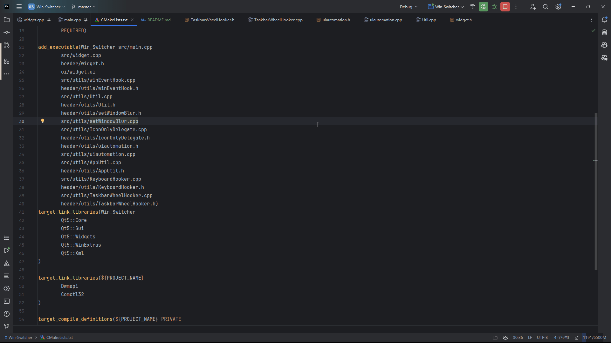
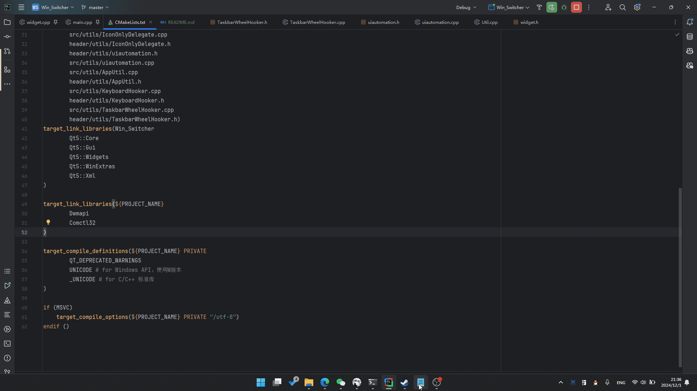

# SwitchTask


一款 macOS 风格的 `Alt-Tab` **窗口**切换器——列表中**每个窗口独立一项**，不按应用合并。支持 `Windows` 10 / 11（64 位）💻️:


## ⚡主要功能

### 1. ``` Alt+Tab ```: 在窗口🪟间切换

- 按住`Shift`反向切换
- 松开`Alt`后切换器保持显示，鼠标单击图标**直接切换**（`Enter`/空格 亦可确认），`Esc`/点击别处 取消
- 鼠标悬停在图标上**实时选中**：底部描述随鼠标位置即时更新（无需先点击）
- **鼠标中键**单击图标 = 关闭该窗口（发送正常关闭请求，可触发应用自身的保存确认）
- 每个窗口独立一个图标（不按应用合并），按各自**最近使用**排序；选中时底部显示该窗口标题



### 2. ``` Alt+` ```: 在同一应用的不同**窗口**🪟间轮换

- 按住`Shift`反向切换
- **最近活动**的窗口优先访问
- 弹出器未显示时用于同组窗口轮换（弹出器显示时 `` ` `` 键用于列表选择）



### 3. `Alt+Tab` 呼出窗口切换器后，可用`🖱️鼠标滚轮`操作指定窗口

- 向上滚轮：该窗口**置顶预览**（不改变焦点）
- 向下滚轮：**最小化**该窗口

#### ⌨️支持键盘操作

- 方向键:
    - ⬅️ ➡️: 切换当前选中的窗口
    - ⬆️ ⬇️: 映射到滚轮上下（置顶预览 / 最小化当前窗口）
- 支持`Vim`风格的快捷键:
    - `h` `l`: 切换当前选中的窗口
    - `j` `k`: 置顶预览 / 最小化当前窗口
- `Tab` / `Shift`+`Tab`: 向右 / 向左循环选择
- `` ` `` / `Shift`+`` ` ``: 向左 / 向右循环选择
- `单击`图标: 直接切换（点哪个切哪个）
- `中键单击`图标: 关闭该窗口
- `Ctrl`+`W`: 关闭当前选中的窗口（等效中键单击）
- `Enter` / `空格`: 确认切换（键盘路径）
- `Esc` / 点击别处: 取消



### 4. 在`任务栏`的应用图标上使用`🖱️鼠标滚轮`切换窗口. 🚧`[Beta]`🚧

> [!CAUTION]
> 实验性功能，仍在测试中，可能会遇到一些问题
>
> 例如：对某些应用程序失效

- 向上滚轮：切换到上一个窗口
- 向下滚轮：**最小化**上一个窗口



## 🌟更多特色

- 窗口背景**毛玻璃**特效
    - 
- 适配`Win11`的窗口圆角效果
- 在`QQ`🐧图标右下角显示当前聊天好友`头像`
    - 
- 支持在更高权限窗口上使用`Alt+Tab`切换
- 更合理的窗口过滤规则
- **高 DPI 适配**：Per-Monitor V2 逐屏缩放感知，支持 4K / 8K 等高分辨率显示器
- 支持多屏幕显示；可切换显示屏幕：跟随鼠标所在屏幕 / 主屏幕
- **macOS 风格设计**：弹窗背景为微圆角矩形（r=8，与系统原生圆角弧度一致）+ 细描边；选中底为方圆角（连续曲率）；选中项图标放大动效（马卡龙·婴儿蓝选中态）；垂直留白对称（图标顶边距 = 文字底边距，随标题字号动态调整）；底部标题超长时中部省略（…），面板会为初始标题自适应加宽
- 应用过多时**自动压缩**图标与单元格（随数量自适应，下限 48px），保证整行容纳在屏幕内

## ✒️TO-DO

- [x] 单例模式
- [x] 自适应app太多的情况
- [x] 支持配置开启启动项
- [x] 支持管理管理员权限窗口
- [ ] 自定义配置
- [ ] 多行布局（应用过多时的备选呈现方案，设计已完成待实施）
- [ ] ...

## 🔑以管理员身份运行（可选）

`SwitchTask`可以在普通用户权限下运行，但有一定的局限性：

只有以**管理员身份**运行，`SwitchTask`才能管理拥有更高权限的窗口，例如：

- 系统窗口：如任务管理器
- 管理员权限窗口：如游戏加速器

> **增强说明**：非管理员模式下，高权限窗口也会照常出现在切换列表中；若系统拦截了焦点切换，会自动将其置顶并闪烁提示（不抢焦点），点击一次即可激活。

### 开机自启动

在托盘菜单中点击`Start with Windows`即可设置开机自启动，自启动时的权限与当前程序权限一致

- 若当前程序以**管理员**权限运行，则开机自启动也会以管理员权限运行（计划任务）🔑
- 若当前程序以**普通**权限运行，则开机自启动也会以普通权限运行（注册表）

## ⚙配置

配置保存在`config.ini`文件中，有两种方式可以修改配置：

1. 直接修改程序目录下的`config.ini`文件，并重启程序
2. 🌟\[推荐\] 使用托盘菜单（右键托盘图标）中的`Settings`选项，此时会自动用`notepad`打开配置文件；
   修改后，保存并**关闭文件**，程序会自动重载配置

### 配置项

#### 字体

```ini
[label]
font_family = "Microsoft YaHei UI"
font_size = 10
font_weight = 400
```

> `font_size` 支持小数，如 `10.5`（100% 缩放下恰好为 14px，显示更清晰）。
> `font_weight` 字重（可选）：`400` 常规 / `500` 中等 / `600` 半粗 / `700` 粗体，也可写 `bold` / `normal`。
