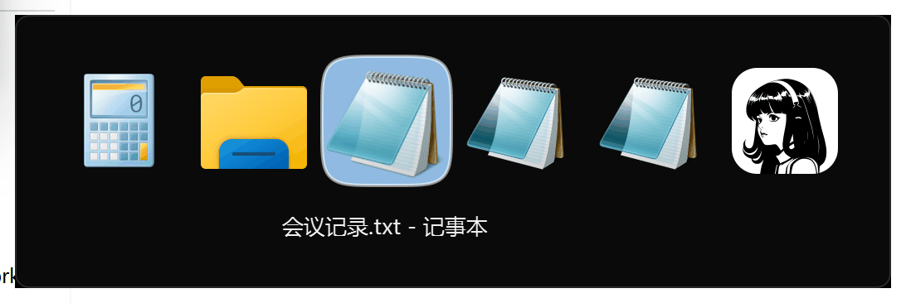

# SwitchTask


一款 macOS 风格的 Windows 窗口切换器：列表中的**每个窗口独立一项**、按最近使用排序、即选即切。支持 `Windows` 10 / 11（64 位）。


## ⚡ 主要功能

### 1. `Alt+Tab`：在窗口间切换

- 按住 `Shift` 反向切换；选中项高亮（方圆角选中底 + 图标放大动效）
- 松开 `Alt` 后切换器保持显示：鼠标单击图标**直接切换**（`Enter` / 空格亦可确认），`Esc` / 点击别处取消
- 每个窗口独立一项，按各自**最近使用**排序；底部实时显示选中窗口的标题（超长中部省略）



### 2. 鼠标悬停即时选中 · 中键关闭窗口

- 鼠标悬停在图标上**实时选中**：底部标题随鼠标位置即时更新，无需先点击
- **鼠标中键**单击图标 = 关闭该窗口（发送正常关闭请求，可触发应用自身的保存确认）
- `Ctrl`+`W`：关闭当前选中的窗口（等效中键单击）


### 3. `Alt+`` `：在同一应用的多个窗口间轮换

- 按住 `Shift` 反向切换；**最近活动**的窗口优先访问
- 切换器未显示时用于同应用窗口轮换（显示时 `` ` `` 键用于列表选择）

### 4. 滚轮与键盘操作

- 滚轮悬停图标：↑ 该窗口**置顶预览**（不改变焦点）/ ↓ **最小化**该窗口
- 方向键 / `Tab`·`Shift`+`Tab` / `` ` ``·`Shift`+`` ` ``：循环选择
- Vim 风格快捷键：`H` `L` 切换选中 / `K` 置顶预览 · `J` 最小化（与方向键 ↑/↓ 语义一致）
- `Enter` / 空格：确认切换 · `Esc` / 点击别处：取消

### 5. 任务栏滚轮（Beta）

在任务栏应用图标上滚动：↑ 切换到上一个窗口 / ↓ 最小化上一个窗口。实验性功能，部分应用可能失效。

## 🌟 更多特色

- **macOS 风格设计**：微圆角矩形背景（r=8，与系统原生圆角弧度一致）+ 细描边；马卡龙·婴儿蓝方圆角选中底（连续曲率）；选中项图标放大动效；垂直留白对称（图标顶边距 = 文字底边距，随标题字号动态调整）；面板为初始标题自适应加宽
- **深浅色模式自适应**：弹窗、托盘菜单（圆角 + 毛玻璃）、更新窗口跟随系统浅色 / 深色模式实时切换；可用 `config.ini` 的 `ThemeMode` 强制指定
- 窗口背景**毛玻璃**特效 + 适配 `Win11` 窗口圆角
- **高 DPI 适配**：Per-Monitor V2 逐屏缩放感知，支持 4K / 8K 等高分辨率显示器
- 支持多屏幕显示（跟随鼠标所在屏幕 / 主屏幕）
- 聊天窗口多开时，可在应用图标上叠加**当前会话头像角标**，各窗口一眼可辨
- 更高权限的窗口（如任务管理器）也能正常切换
- 应用过多时**自动压缩**图标与单元格，保证整行容纳在屏幕内
- 内置**自动更新**检查；标题字体可配置

## ✒️ 更多任务（可选开发）

- [ ] 自定义配置
- [ ] 多行布局（窗口过多时的备选呈现方案）
- [ ] ...

## 🚀 开机自启动

在托盘菜单中点击 `Start with Windows` 即可设置开机自启动（再次点击取消），启动权限与当前程序权限一致。

## ⚙ 配置

配置保存在 `config.ini` 文件中，有两种方式可以修改配置：

1. 直接修改程序目录下的 `config.ini` 文件，并重启程序（若程序目录不可写——如安装在 Program Files——配置会自动回退到 `%LOCALAPPDATA%` 下的应用数据目录）
2. 🌟\[推荐\] 使用托盘菜单（右键托盘图标）中的 `Settings` 选项，此时会自动用文本编辑器打开配置文件；修改后，保存并**关闭文件**，程序会自动重载配置

### 配置项

#### 字体

```ini
[label]
font_family = "Microsoft YaHei UI"
font_size = 10
font_weight = bold
```

> `font_size` 支持小数，如 `10.5`（100% 缩放下恰好为 14px，显示更清晰）。
> `font_weight` 字重：默认为 `bold`；也可写 `400` 常规 / `500` 中等 / `600` 半粗 / `700` 粗体，或 `normal`。

#### 界面

```ini
ThemeMode = auto
DisplayMonitor = 1
```

> `ThemeMode`：`auto` 跟随系统深浅色（默认）/ `light` 浅色 / `dark` 深色；也可写 `0` / `1` / `2`。
> `DisplayMonitor`：`0` 主屏幕 / `1` 跟随鼠标所在屏幕（默认）；与托盘菜单「Display Monitor」同步。

## 📄 License

本项目采用 [GPL-3.0](LICENSE) 许可发布：可自由使用、修改与分发，衍生作品须同样以 GPL-3.0 开源。

© 2026 Crucialmer
